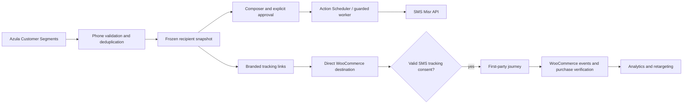

# Azula SMS Studio

**Consent-aware, first-party SMS journey tracking and behavioral retargeting for WooCommerce.**

Built for **Azula Sportswear**, an Egypt-focused e-commerce store, this custom WordPress platform connects customer segmentation, SMS campaign operations, branded tracking links, behavioral analytics, WooCommerce purchases and controlled background execution.

> **Project status:** RC18 portfolio case study. The sanitized source ZIP has been prepared separately; source import and screenshot upload are still pending in this GitHub repository. Documentation does not imply that every production verification has passed.

## Why we built it

SMS Misr handles the SMS provider infrastructure, but our business needed marketing capabilities beyond simply sending campaigns from an external dashboard. We wanted campaign management, segmented recipients, tracking, revenue attribution and retargeting **inside our own WooCommerce environment**.

**Our workflow:** Customer Segments → audience preparation and Egyptian phone normalization → immutable campaign review → SMS Misr submission → branded recipient links → consent-aware shopping journeys → campaign analytics → behavioral audiences.

## The engineering highlights

### Branded first-party links and attribution

- Recipient-specific branded URLs redirect directly to the intended store destination.
- Permitted journeys can record SMS clicks, add-to-cart, checkout and qualifying WooCommerce purchases.
- Seven-day SMS attribution window, separate from the 24-hour potential-abandonment waiting period.
- Campaign/global reporting for attempted, provider-accepted, rejected and unknown outcomes, clicks, commerce events and attributed revenue.
- **Provider acceptance does not prove handset delivery.** Missing tracking events are **UNKNOWN**, not proof a person took no action.

### Behavioral retargeting

SMS Studio builds its own snapshot/dynamic audiences. It supports positive clicked audiences, buyer-verified purchaser audiences and **potential** cart/checkout recovery, with independent WooCommerce purchase checks before recovery targeting. A recorded link belongs to an intended recipient, not necessarily the person physically operating the browser. Consent loss and cross-device journeys limit inference.

**Example:** A customer clicks an SMS, adds leggings to cart and begins checkout. After an inactivity period the system can evaluate a recovery audience, but suppresses reliably matched buyers and withholds uncertain identity/order evidence. This is deliberately safer than assuming that an unrecorded purchase did not happen.

### Customer Segments and phone data quality

- Read-only integration with the separate Azula Customer Segments plugin.
- Egyptian number normalization across supported local, +20, 0020 and 20-prefixed formats.
- Rejection of missing/invalid/ambiguous numbers; deduplication by normalized recipient.
- Original customer phone values are not rewritten.
- Frozen approved audiences protect against unexpected segment drift between review and submission.

### SMS Misr and campaign controls

- SMS Misr provider integration, sender configuration, balance checks and parsed submission outcomes.
- Message composition, Unicode/encoding and estimated SMS-unit calculations.
- Approval gates, recipient limits, immutable send authorization and guarded retry handling.
- Consent-aware tracking with compact accept/decline controls and reversible permissions.

### Background scheduling on Hostinger

WordPress **Action Scheduler** coordinates approved send jobs. A **Hostinger server-side cron job approximately every five minutes** helps wake processing regardless of whether the administrator is logged in or the laptop is switched on. Africa/Cairo schedule selections are stored in UTC. Worker checks, locks and durable attempt claims help limit duplicate sends. A background runner is independent of the local browser, but execution still depends on hosting and runner health.

## Architecture

## Technical stack

WordPress, WooCommerce, PHP, JavaScript, WooCommerce Action Scheduler, SMS Misr HTTP API, first-party attribution, Hostinger cron scheduling, and a separate custom Customer Segments plugin.

The export is based on **1.0.0-rc.18 (RC18)** and is application-specific rather than a general-purpose one-click plugin. It depends on other private Azula plugins and explicit production safeguards.

## Development and validation

The work progressed from a dispatch-disabled audience and normalization foundation through message composition, provider integration, tracking, consent, customer journey attribution, WooCommerce recovery verification and production safety gates.

RC18's local review reported **445 PHP/SQL checks and 63 browser cases**. The publication package separately reported **64 assertions, 117 PHP and 12 JS syntax checks**. These are reported test results, **not an independent certification of LIVE delivery or all customer journeys**.

## Screenshots and source publication

Six redacted admin screenshots are prepared for the portfolio: analytics, SMS Misr integration, campaign management, audience preparation, composer and retargeting. They and the sanitized RC18 source package will be added to this repository once transfer and verification are complete. **Do not interpret an absent source directory as the implementation being published here already.**

## V2 — Automated Customer Lifecycle Marketing

**Planned, target development: November 2026 — not RC18 functionality.**

- 30-day no-purchase win-back messages.
- Collection-based product recommendations.
- Personalized post-purchase follow-ups.
- New-order confirmations and shipment tracking messages.
- Behavior-triggered workflows with suppression, consent, throttling and frequency controls.

## Security and rights

The separate source publication was reviewed to exclude customer data, credentials, internal infrastructure artifacts, LIVE logs and private Git history. Any public screenshots must be separately redacted. **No standalone license has been granted yet**, pending ownership and compatibility review. WordPress/GPL obligations may still apply.

**Built for a real WooCommerce business problem: connecting SMS delivery to measurable, privacy-aware commerce workflows.**
